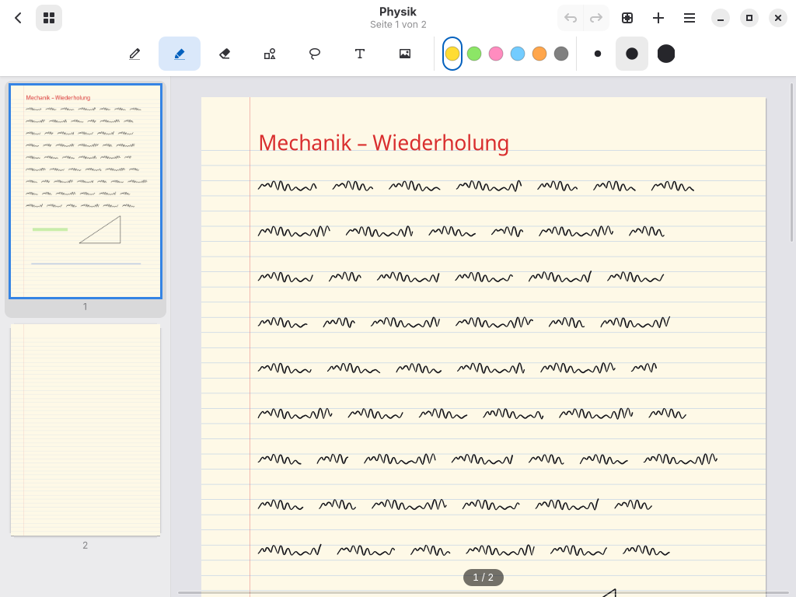
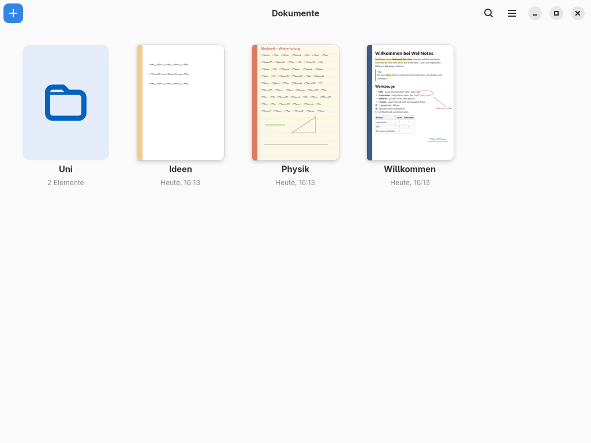
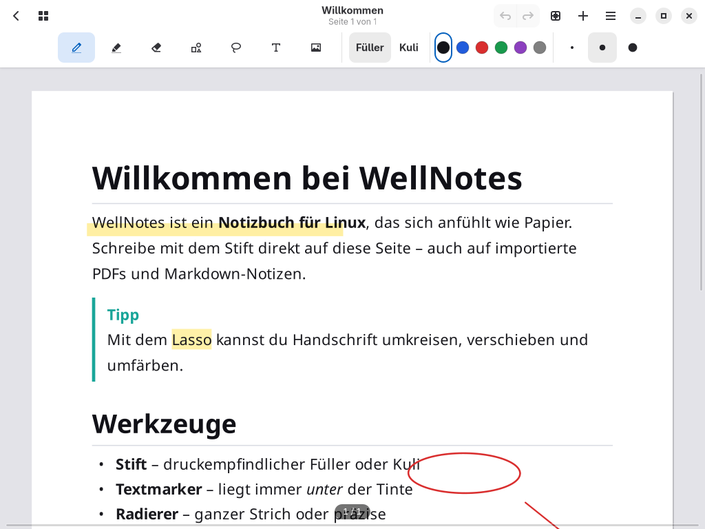
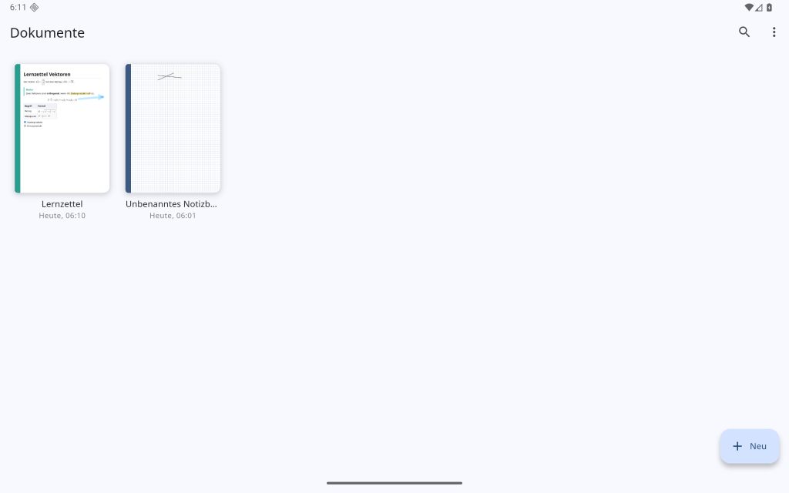

# WellNotes

**Handschriftliche Notizen für Linux und Android – mit Stift-Unterstützung und kompatibel mit `.goodnotes`-Dateien.**

*English: WellNotes is a handwriting notes app for Linux (native GTK 4) and Android (Flutter). It opens and saves `.goodnotes` files, supports pen pressure and stylus erasers, imports PDF, Markdown (with LaTeX), Obsidian vaults and Notion exports, and syncs notebooks between devices via Nextcloud, Google Drive or any folder. The UI is in German.*



| Bibliothek | Markdown-Notiz mit Anmerkungen |
|---|---|
|  |  |

## Funktionen

- **Schreiben wie auf Papier.**
  - Füller mit Druckstufen oder Kuli, frei einstellbare Stärken, Textmarker
  - Radierer (ganzer Strich oder präzise), Formerkennung, Lasso zum Verschieben, Skalieren und Umfärben
  - Textfelder (auf Wunsch genau auf den Papierlinien) und Bilder
- **Flüssig auch auf älteren Tablets.** GPU-Texturen, inkrementelles Zeichnen und Rendern im Hintergrund
- **Stift-Unterstützung.** Wacom, Huion, XP-Pen, Surface-Pen und andere Grafiktabletts:
  - Druck steuert die Strichstärke.
  - Die Radierer-Spitze und die Stifttaste radieren.
  - Handflächenerkennung: Finger scrollen (mit Schwung) und zoomen.
  - Wischgesten schließen nie versehentlich ein Heft.
- **Notizbücher.** Endlos scrollbare Seiten, Seitenübersicht, Vollbildmodus, Papiervorlagen (blanko, liniert, kariert, gepunktet), Umschläge, Ordner, Suche, Undo/Redo, Autosave
- **`.goodnotes` lesen und schreiben.** Das Containerformat von GoodNotes 6 wurde zurückentwickelt ([Spezifikation](docs/goodnotes-format.md)).
- **Importieren.**
  - PDF, Bilder
  - Markdown: wird schön gesetzt, **inklusive LaTeX-Formeln** (auch Matrizen), und lässt sich mit dem Stift beschreiben
  - **Obsidian-Vaults** mit Wikilinks, Bildern, Einbettungen und Callouts
  - Logseq-/Joplin-Ordner, **Notion**-ZIP-Exporte
- **Synchronisieren.** Mit **Nextcloud/WebDAV**, **Google Drive** oder einem beliebigen Ordner, in beide Richtungen und mit Konfliktkopien
- **Exportieren.** Als Vektor-PDF oder `.goodnotes`
- **Android-App.** Dieselben Notizbücher auf dem Android-Tablet: Stift mit Druck, alle Werkzeuge, Markdown/LaTeX-Import und Nextcloud-Sync mit der Linux-App ([mehr](docs/android.md))

| Android-Tablet: Bibliothek | Android-Tablet: Notizbuch |
|---|---|
|  |  |

## Installation

### Arch Linux

```bash
git clone https://github.com/bonbon08/wellnotes.git
cd wellnotes/packaging/arch
makepkg -si
```

Das [PKGBUILD](packaging/arch/PKGBUILD) baut die veröffentlichte Version aus dem GitHub-Release und installiert:
- den Starter `wellnotes`
- den Menüeintrag und das Icon
- die Dateizuordnung für `.goodnotes`
- die AppStream-Metadaten

### Android

Unter [Releases](https://github.com/bonbon08/wellnotes/releases) die passende APK herunterladen und installieren (Installation aus unbekannten Quellen erlauben):
- `wellnotes-android-arm64-v8a.apk` für fast alle aktuellen Tablets und Handys
- `wellnotes-android-armeabi-v7a.apk` für ältere 32-Bit-Geräte
- `wellnotes-android-universal.apk`, falls unklar (größer)

Benötigt Android 7 oder neuer. Details stehen in der [Android-Anleitung](docs/android.md).

### Linux aus dem Quellcode (jede Distribution)

Benötigt: Python ≥ 3.10, PyGObject, pycairo, GTK 4, libadwaita ≥ 1.5, Poppler-GLib, librsvg; optional Matplotlib für LaTeX-Formeln.

```bash
# Arch:          sudo pacman -S python-gobject python-cairo gtk4 libadwaita poppler-glib python-matplotlib
# Fedora:        sudo dnf install python3-gobject python3-cairo gtk4 libadwaita poppler-glib
# Debian/Ubuntu: sudo apt install python3-gi python3-gi-cairo gir1.2-gtk-4.0 gir1.2-adw-1 gir1.2-poppler-0.18
git clone https://github.com/bonbon08/wellnotes.git && cd wellnotes
./bin/wellnotes          # direkt starten
./install.sh             # optional: Starter, Icon und Dateizuordnung für den eigenen Benutzer
```

## Dokumentation

- [Benutzerhandbuch](docs/benutzerhandbuch.md): Werkzeuge, Tastenkürzel, Import, Export, Synchronisation einrichten, Problemlösung
- [Android-App](docs/android.md): Installation, Bedienung, Unterschiede zur Linux-Version
- [Das `.goodnotes`-Format](docs/goodnotes-format.md): zurückentwickelte Spezifikation
- [Entwicklung](docs/entwicklung.md): Architektur, Tests, Pakete bauen, Release

## Status und Grenzen

WellNotes ist ein junges Projekt (Version 0.4).
- **Lesen von `.goodnotes`**: an einer echten Datei geprüft.
- **Schreiben**: Ob GoodNotes selbst die von WellNotes geschriebenen Dateien öffnet, ist noch nicht getestet. Rückmeldungen sind sehr willkommen.
- **Weitere Grenzen**: stehen im [Format-Dokument](docs/goodnotes-format.md#grenzen).

WellNotes ist ein unabhängiges Open-Source-Projekt und steht in keiner Verbindung zu GoodNotes Limited. „GoodNotes“ wird nur genannt, um die Dateikompatibilität zu beschreiben.

## Lizenz

[GPL-3.0-or-later](LICENSE)
