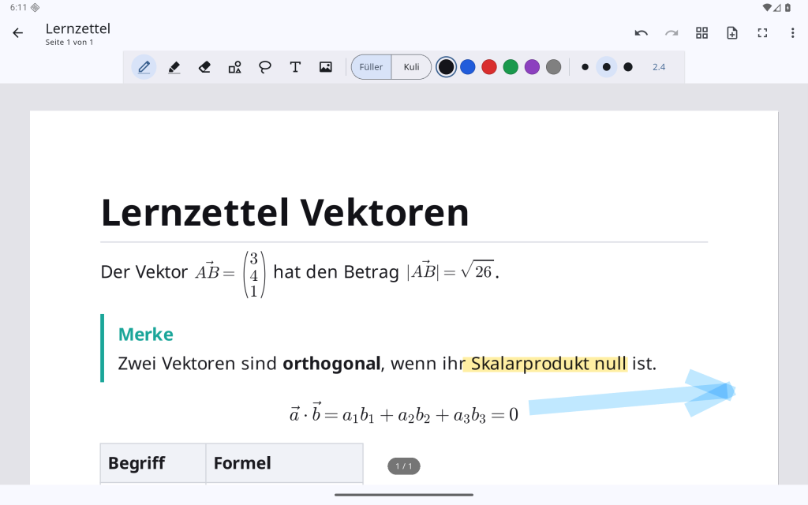

# WellNotes für Android

Die Android-App öffnet und bearbeitet dieselben `.goodnotes`-Notizbücher wie die Linux-Version. Über Nextcloud lassen sich beide Geräte abgleichen.

## Installation

1. Unter [Releases](https://github.com/bonbon08/wellnotes/releases) die APK für dein Gerät laden:
   - `wellnotes-android-arm64-v8a.apk` für fast alle aktuellen Geräte
   - `wellnotes-android-armeabi-v7a.apk` für ältere 32-Bit-Geräte
   - `wellnotes-android-universal.apk`, falls unklar
2. Öffnen und die Installation aus dieser Quelle erlauben.

Voraussetzung ist Android 7 oder neuer. Die APKs sind mit einem Entwicklerschlüssel signiert. Spätere Versionen aus diesem Repository lassen sich darüber installieren, ohne Daten zu verlieren.

## Bedienung

Die App ist aufgebaut wie die Linux-Version:
- **Bibliothek** mit Umschlägen und Ordnern. Mit „Neu“ legst du Notizbücher und Ordner an oder importierst. Langes Drücken öffnet Umbenennen, Duplizieren, Teilen, Verschieben und Löschen. Gelöschtes landet in `.trash`.
- **Notizbuch** mit Werkzeugleiste: Stift (Füller/Kuli), Textmarker, Radierer (ganzer Strich/präzise), Formen, Lasso, Text, Bild.
  - Größen: drei Vorgaben, ein Tipp auf die Zahl öffnet den Regler.
- **Stift**: Druck steuert die Strichstärke, die Radierer-Spitze radiert.
  - Finger scrollen mit Schwung und zoomen mit zwei Fingern, damit die aufliegende Hand nicht zeichnet.
  - *Mit dem Finger zeichnen* im Menü ⋮ schaltet Fingerzeichnen ein.
- **Text auf Linien**: Auf liniertem, kariertem oder gepunktetem Papier stehen Textzeilen genau auf den Linien.
- **Vollbild** über das Symbol in der Titelleiste. Dabei werden auch die Android-Leisten ausgeblendet.
- **Zurück**: Ein versehentliches Wischen schließt kein Notizbuch. Es braucht ein zweites „Zurück“ innerhalb von zwei Sekunden oder den Pfeil oben links.
- **Seitenübersicht** (Raster-Symbol): Antippen springt zur Seite. Langes Drücken öffnet Einfügen, Duplizieren, Verschieben und Löschen.
- **Autosave** 1,5 Sekunden nach jeder Änderung und sofort, wenn die App in den Hintergrund geht.

## Importieren

- **PDF, Bilder, Markdown, `.goodnotes`**: über „Neu → Importieren…“.
- **Obsidian-Vault, Notion-Export**: als **ZIP** über „Importieren…“.
  - Android erlaubt Apps meist keinen direkten Zugriff auf beliebige Ordner. Deshalb funktioniert „Obsidian-Vault / Markdown-Ordner…“ nur bei Ordnern, auf die WellNotes zugreifen darf.
- **Markdown** wird wie unter Linux gesetzt:
  - Überschriften, Listen, Aufgaben, Tabellen, Code, Zitate
  - Obsidian-Callouts, Wikilinks, Bild- und Notiz-Einbettungen, Markierungen, Tags
  - **LaTeX-Formeln** (KaTeX-Syntax, auch Matrizen, `cases`, `aligned`)

## Synchronisation

Unter ⋮ → **Einstellungen** trägst du Nextcloud-Server, Benutzer, **App-Passwort** und Ordner ein. Nimm denselben Ordner wie in der Linux-App, dann gleichen beide Geräte dieselben Notizbücher ab.
- Abgleich: beim Start, nach dem Schließen eines Notizbuchs, im eingestellten Intervall und über den Sync-Knopf.
- „Nach unten ziehen“ in der Bibliothek synchronisiert ebenfalls.

Die Regeln sind dieselben wie unter Linux:
- Bei Änderungen auf beiden Seiten entsteht eine Konfliktkopie.
- Geöffnete Notizbücher werden nicht von außen überschrieben.

Das Passwort liegt verschlüsselt im Android-Schlüsselspeicher.

## Wo liegen die Daten?

Unter `Android/data/io.github.wellnotes.wellnotes/files/WellNotes` (per USB erreichbar). Jedes Notizbuch ist eine normale `.goodnotes`-Datei.

## Unterschiede zur Linux-Version

| | Linux | Android |
|---|---|---|
| Sync | Nextcloud/WebDAV, Google Drive, Ordner | Nextcloud/WebDAV |
| Vault-Import | Ordner direkt | als ZIP (Ordner nur mit Zugriffsrecht) |
| PDF-Export | Vektor-PDF | Seiten als Bilder in hoher Auflösung, über „Teilen“ |
| `.goodnotes`-Export von Textfeldern auf PDF-Seiten | in die Seitenvorlage eingebettet | nur in `wellnotes.json` (in WellNotes sichtbar) |

**Getestet** auf einem emulierten Android-36-Tablet:
- Stift- und Fingereingabe sowie Markdown/LaTeX
- Laden und Speichern im Austausch mit der Linux-App

Auf echter Stift-Hardware (z. B. S-Pen) ist die App noch nicht getestet. Rückmeldungen sind willkommen.
