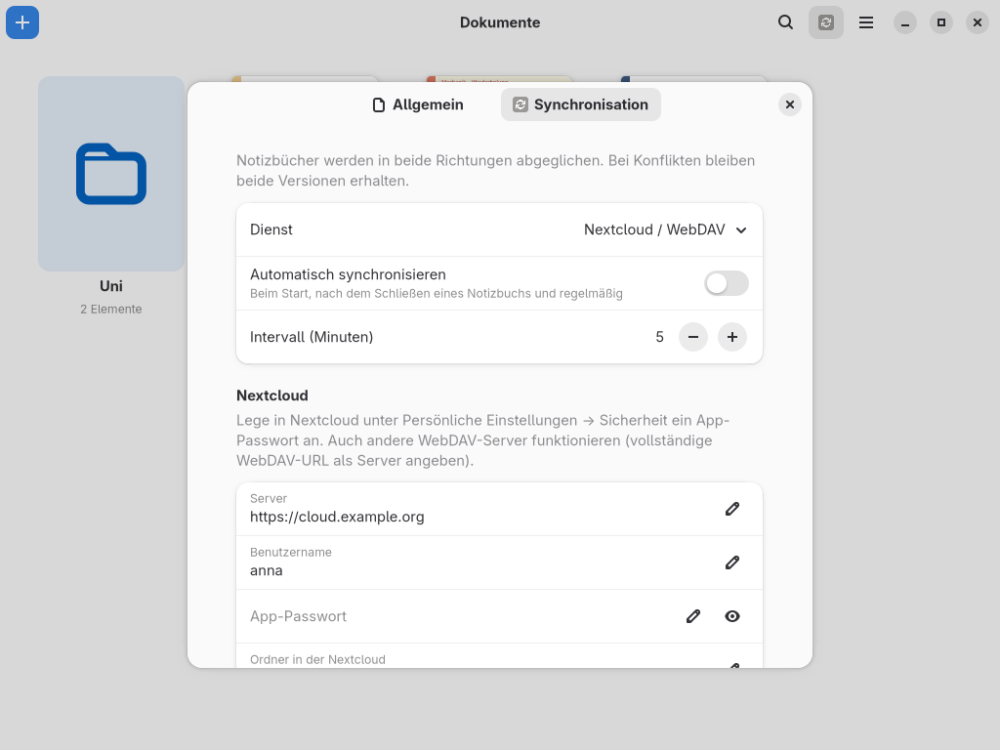

# Benutzerhandbuch

## Inhalt
1. [Bibliothek](#bibliothek)
2. [Notizbuch und Werkzeuge](#notizbuch-und-werkzeuge)
3. [Stift, Touch und Handflächenerkennung](#stift-touch-und-handflächenerkennung)
4. [Seiten](#seiten)
5. [Importieren](#importieren)
6. [Exportieren](#exportieren)
7. [Synchronisation einrichten](#synchronisation-einrichten)
8. [Tastenkürzel](#tastenkürzel)
9. [Wo liegen meine Daten?](#wo-liegen-meine-daten)
10. [Problemlösung](#problemlösung)

---

## Bibliothek

Nach dem Start zeigt WellNotes die Bibliothek mit allen Notizbüchern und Ordnern.

- **Neu (+)**
  - *Notizbuch*: Titel, Format (A4, A4 quer, US Letter, A5), Umschlagfarbe, Papier und Papierfarbe wählen
  - *Ordner*
  - *Importieren…*
  - *Obsidian-Vault / Markdown-Ordner…*
- **Öffnen**: Klick auf ein Notizbuch oder einen Ordner. Der Pfeil oben links führt zurück zum übergeordneten Ordner.
- **Kontextmenü** (Rechtsklick oder langes Drücken): Umbenennen, Duplizieren, Als PDF exportieren, Verschieben, Löschen. Gelöschtes landet im Papierkorb.
- **Suche** (Lupe oder Strg+F): filtert den aktuellen Ordner nach Namen
- **Sortieren** (Menü): nach Datum oder Name
- **Drag & Drop**: Ziehe PDFs, Markdown-Dateien, Bilder, `.goodnotes`-Dateien, ZIP-Exporte oder ganze Ordner in das Fenster.
- **Sync-Knopf** (erscheint, wenn eine Synchronisation eingerichtet ist): startet sofort einen Abgleich

## Notizbuch und Werkzeuge

Die Werkzeugleiste unter der Titelleiste enthält die Werkzeuge. Rechts daneben stehen die Optionen des gewählten Werkzeugs.

| Werkzeug | Taste | Bedienung | Optionen |
|---|---|---|---|
| Stift | P | Schreiben | *Füller* (Stärke folgt dem Druck) oder *Kuli* (gleichmäßig); 5 Farben + eigene Farbe; Stärke (siehe unten) |
| Textmarker | H | Markieren | 5 Farben, Stärke. Die Markierung liegt immer *unter* der Tinte. |
| Radierer | E | Über Striche fahren | *Ganzer Strich* löscht berührte Striche, *Präzise* radiert nur den berührten Teil; Größe |
| Formen | S | Form freihand zeichnen und loslassen | Wird zu Linie, Dreieck, Rechteck, Polygon, Ellipse oder Kreis. Nicht erkannte Formen bleiben freihand. |
| Lasso | L | Elemente umkreisen | Auswahl verschieben (ziehen), an den Ecken skalieren; Menü: Ausschneiden, Kopieren, Duplizieren, Löschen, Farbe ändern |
| Text | T | Auf die Seite klicken | Neues Textfeld oder vorhandenes bearbeiten; Esc oder Klick daneben beendet die Eingabe; Größe, Farben; *Auf Linien* (siehe unten) |
| Bild | – | Datei wählen | Wird mittig eingefügt und ist sofort ausgewählt. Bilder lassen sich auch mit Strg+V aus der Zwischenablage einfügen. |

**Eigene Farbe.** Der graue Farbpunkt ist frei belegbar: einmal klicken öffnet die Farbauswahl, Rechtsklick ändert die Farbe später.

**Stärke und Größe.** Jedes Werkzeug hat drei Vorgaben (die Punkte) und daneben einen Knopf mit der genauen Zahl.
- Der Knopf öffnet einen Regler und ein Eingabefeld für beliebige Werte. Die Spanne reicht beim Stift von 0,3 bis 30, beim Text von 8 bis 140.
- Was du dort einstellst, wird zur aktuell gewählten Vorgabe und bleibt gespeichert. So kannst du dir die drei Punkte selbst belegen.

**Text auf den Linien.** Mit *Auf Linien* (Optionen des Text-Werkzeugs, standardmäßig an) landet getippter Text auf liniertem, kariertem oder gepunktetem Papier genau auf den Linien.
- Die Schriftgröße passt sich dem Linienabstand an.
- Jede Textzeile steht auf einer Linie, auch beim automatischen Umbruch.
- Auf liniertem Papier beginnt der Text rechts vom roten Rand.

Ist *Auf Linien* aus, oder bei Blanko- und PDF-Seiten, gilt die eingestellte Textgröße.

**Zoom.** Strg+Mausrad, Pinch-Geste am Touchpad oder Touchscreen, Strg+Plus/Minus. Strg+0 passt wieder an die Breite an (Knopf in der Titelleiste).

**Vollbild.** F11 oder der Knopf mit den Pfeilen in der Titelleiste. Die Titelleiste verschwindet, und die Werkzeugleiste zeigt links *Vollbild verlassen* und Rückgängig/Wiederholen, rechts die Seitenzahl und *Neue Seite*. Mit F11 geht es zurück.

**Zurück zur Bibliothek.** Nur über den Pfeil oben links oder Alt+←. Wischgesten und die Esc-Taste schließen ein Notizbuch absichtlich *nicht*, damit nichts versehentlich zugeht.

**Rückgängig/Wiederholen.** Strg+Z / Strg+Umschalt+Z oder die Pfeile in der Titelleiste. Das gilt auch für Radieren, Verschieben und Seitenänderungen.

**Speichern.** Passiert automatisch 1,5 Sekunden nach jeder Änderung und beim Schließen. Strg+S speichert sofort.

## Stift, Touch und Handflächenerkennung

WellNotes nutzt die Tablet-Unterstützung von GTK 4 und funktioniert damit unter Wayland und X11 mit Wacom, Huion, XP-Pen, Surface-Pen und anderen Stift-Displays.

- **Druck** steuert die Strichstärke des Füllers.
- **Radierer-Spitze** (Stift umdrehen) und **Stifttaste gedrückt halten** radieren, egal welches Werkzeug gewählt ist.
- **Finger** scrollen und zoomen standardmäßig. So zeichnet die aufliegende Hand nicht mit.
- **Mit dem Finger zeichnen** (Menü ☰ im Notizbuch) schaltet Fingerzeichnen ein. Sobald ein Stift benutzt wurde, scrollen Finger wieder, damit die Handflächenerkennung greift.
- Mit **zwei Fingern** zoomen und gleichzeitig verschieben; der Inhalt bleibt dabei unter den Fingern.
- Nach einem schnellen **Wisch mit dem Finger** gleitet die Seite noch etwas weiter, wie in Tablet-Apps üblich.
- Die **mittlere Maustaste** verschiebt die Ansicht.

**Leistung auf älteren Geräten.** Damit Schreiben auch auf schwachen Tablets flüssig bleibt:
- Seiten liegen als Texturen auf der Grafikkarte.
- Ein neuer Strich wird während des Schreibens nur stückweise ergänzt.
- Seiten werden im Hintergrund gezeichnet.

## Seiten

- **Neue Seite**: „+“ in der Titelleiste oder Strg+Umschalt+N. Sie bekommt dieselbe Vorlage wie die aktuelle Seite.
- **Seitenübersicht**: Raster-Knopf oben links. Klick springt zur Seite; Rechtsklick: davor/danach einfügen, duplizieren, nach oben/unten, löschen.
- **Papiervorlage ändern** (Menü ☰): für die aktuelle Seite oder alle Seiten. PDF-Seiten behalten ihren Hintergrund.
- **PDF, Markdown oder Bild einfügen** (Menü ☰): Die neuen Seiten kommen hinter die aktuelle Seite.

## Importieren

| Quelle | So geht’s | Ergebnis |
|---|---|---|
| PDF | Importieren… oder Drag & Drop | Ein Notizbuch, jede PDF-Seite wird beschreibbarer Hintergrund |
| Markdown (`.md`) | Importieren… oder Drag & Drop | Wird typografisch gesetzt und ist dann beschreibbar wie ein PDF |
| Bild | Importieren… oder Drag & Drop | Notizbuch mit dem Bild auf der ersten Seite |
| `.goodnotes` | Importieren… oder Drag & Drop | Wird in die Bibliothek kopiert |
| Obsidian-Vault, Logseq-, Joplin- oder sonstiger Markdown-Ordner | + → *Obsidian-Vault / Markdown-Ordner…* oder Ordner ins Fenster ziehen | Neuer Bibliotheksordner mit gleicher Struktur, jede Notiz und jedes PDF wird ein Notizbuch |
| Notion | Notion → Export → *Markdown & CSV*, ZIP importieren | Wie ein Markdown-Ordner; Notion-IDs werden aus den Namen entfernt |

Große Importe laufen im Hintergrund. Ein Balken oben zeigt den Fortschritt, dort lässt sich der Import auch abbrechen. Die Quelldateien werden nur gelesen, nie verändert.

### Unterstützte Markdown- und Obsidian-Syntax

- **Grundlagen**:
  - Überschriften
  - **fett**, *kursiv*, ~~durchgestrichen~~, `Code`
  - Links
  - verschachtelte Listen, Aufgabenlisten
  - Zitate, Codeblöcke, Tabellen, Trennlinien
  - Bilder (auch mehrere hintereinander, neben Text und in Tabellenzellen; lokale Dateien, Web-Adressen und eingebettete `data:`-Bilder)
- **Obsidian**:
  - `[[Notiz]]`, `[[Notiz|Alias]]`, `[[Notiz#Überschrift]]` werden als Links dargestellt.
  - `![[bild.png]]`, `![[bild.png|300]]`: Das Bild wird irgendwo im Vault gesucht und optional skaliert.
  - `![[Andere Notiz]]`, `![[Andere Notiz#Abschnitt]]`: Inhalt bzw. Abschnitt wird eingebettet.
  - `![[skript.pdf]]`: Die Seiten des PDFs werden an die Notiz angehängt.
  - Callouts `> [!note]`, `> [!warning] Titel` … in passenden Farben
  - `==Markierung==`, `#tags`, Fußnoten `[^1]`
  - `%%Kommentare%%` werden ausgeblendet, ebenso die Properties (YAML-Kopf).
- **LaTeX-Formeln**:
  - `$…$` im Text, `$$…$$` als abgesetzte Formel, auch in Tabellen und Callouts
  - Unterstützt werden Brüche, Wurzeln, Indizes, Integrale, Summen, griechische Buchstaben, `\vec`, `\overline`, `\mathbb`, `\text` …
  - Dazu die Umgebungen `pmatrix`, `bmatrix`, `vmatrix`, `matrix`, `cases` und `aligned`/`align`/`gather`.
  - Voraussetzung ist Matplotlib (`python-matplotlib`). Fehlt es, oder ist eine Formel nicht darstellbar, erscheint der Quelltext kursiv.

Auch eine einzelne `.md`-Datei aus einem Vault findet ihre Bilder und Einbettungen, denn WellNotes erkennt den Vault am Ordner `.obsidian`.

## Exportieren

- **Als PDF** (Menü ☰ im Notizbuch, Strg+E oder Kontextmenü in der Bibliothek): Vektor-PDF in Originalgröße, Handschrift bleibt scharf.
- **Als `.goodnotes`**: Kopie im GoodNotes-Format.

Notizbücher liegen ohnehin als `.goodnotes`-Datei im Bibliotheksordner. Die Kopie ist nur nötig, wenn sie woanders landen soll.

## Synchronisation einrichten

Menü ☰ → **Einstellungen** (Strg+Komma) → **Synchronisation**.

Synchronisiert werden alle Notizbücher und Ordner der Bibliothek, in beide Richtungen:
- beim Start
- nach dem Schließen eines Notizbuchs
- im eingestellten Intervall
- jederzeit über den Sync-Knopf in der Bibliothek

**Verbindung testen** prüft die Einstellungen, ohne etwas zu verändern.

### Nextcloud (oder anderer WebDAV-Server)

1. In Nextcloud: Avatar → *Persönliche Einstellungen* → *Sicherheit* → *Neues App-Passwort erstellen*.
2. In WellNotes:
   - **Dienst**: *Nextcloud / WebDAV*
   - **Server**: z. B. `https://cloud.example.org`
   - **Benutzername**
   - **App-Passwort**: eintragen und mit ✓ bestätigen
3. **Ordner in der Nextcloud**: Vorgabe ist `WellNotes`. Unterordner wie `Notizen/WellNotes` sind möglich, fehlende Ordner werden angelegt.

Für andere WebDAV-Server die vollständige WebDAV-URL als Server eintragen, z. B. `https://dav.example.org/remote.php/webdav`.

### Google Drive

**Variante A: GNOME Online-Konten** (am einfachsten unter GNOME)
1. GNOME-Einstellungen → *Online-Konten* → *Google*. Anmelden und **Dateien** aktivieren.
2. In WellNotes: **Dienst** *Google Drive*, **Anmeldung** *GNOME Online-Konten*. Das Konto wird angezeigt.

**Variante B: Eigene OAuth-Client-ID** (jede Desktop-Umgebung)

Google verlangt für Drive-Zugriffe eine registrierte App. Die Einrichtung dauert einmalig etwa fünf Minuten:
1. [Google Cloud Console](https://console.cloud.google.com/) → neues Projekt anlegen.
2. *APIs und Dienste* → *Bibliothek* → **Google Drive API** aktivieren.
3. *OAuth-Zustimmungsbildschirm*: Typ „Extern“, und dich selbst als Testnutzer eintragen.
4. *Anmeldedaten* → *Anmeldedaten erstellen* → *OAuth-Client-ID* → Typ **Desktop-App**.
5. In WellNotes: **Anmeldung** *Eigene OAuth-Client-ID*, **Client-ID** und **Client-Secret** eintragen, dann **Im Browser anmelden**.

WellNotes fordert nur den Bereich `drive.file` an, sieht also ausschließlich die Dateien, die es selbst angelegt hat. Sie liegen im Ordner `WellNotes` in deinem Drive.

### Ordner

Synchronisiert mit einem beliebigen Ordner, zum Beispiel:
- `~/Nextcloud/WellNotes`, wenn der Nextcloud-Desktop-Client schon läuft
- dem Ordner des Google-Drive- oder Dropbox-Clients
- einem USB-Stick

Der Sync-Ordner darf nicht innerhalb der Bibliothek liegen (und umgekehrt).

**Alternative ohne Sync-Funktion:** Unter *Allgemein → Speicherort* die Bibliothek direkt in einen Ordner legen, den ein Sync-Client abgleicht.

### So verhält sich der Abgleich

| Situation | Ergebnis |
|---|---|
| Nur lokal geändert | wird hochgeladen |
| Nur in der Cloud geändert | wird heruntergeladen |
| Auf beiden Seiten geändert | lokale Version bleibt, die andere wird als „Name (Konflikt Datum).goodnotes“ auf beiden Seiten gespeichert |
| Auf einer Seite gelöscht, auf der anderen unverändert | wird auch dort gelöscht (lokal in den Papierkorb) |
| Notizbuch ist gerade geöffnet | wird nicht von außen überschrieben, sondern nach dem Schließen abgeglichen |
| Erster Abgleich, Datei existiert auf beiden Seiten | identische Dateien werden erkannt, sonst entsteht eine Konfliktkopie |

Passwörter und Tokens liegen im System-Schlüsselbund (libsecret, z. B. GNOME Keyring oder KWallet). Ohne Schlüsselbund landen sie in `~/.config/wellnotes/secrets.json`, nur für dich lesbar.

## Tastenkürzel

| Kürzel | Aktion |
|---|---|
| P / H / E / S / L / T | Stift / Textmarker / Radierer / Formen / Lasso / Text |
| Strg+Z, Strg+Umschalt+Z, Strg+Y | Rückgängig, Wiederholen |
| Strg+X / C / V / D | Ausschneiden, Kopieren, Einfügen, Duplizieren |
| Entf, Rücktaste | Auswahl löschen |
| Strg+Umschalt+N | Neue Seite |
| Bild auf / Bild ab | Vorherige / nächste Seite |
| Strg+Plus / Strg+Minus / Strg+0 | Zoom / an Breite anpassen |
| Strg+S | Sofort speichern |
| F11 | Vollbild ein/aus |
| Alt+← | Zurück zur Bibliothek |
| Strg+E | Als PDF exportieren |
| Strg+N / Strg+O / Strg+F | Neues Notizbuch / Importieren / Suchen (Bibliothek) |
| Strg+Komma | Einstellungen |
| Strg+Q | Beenden |

## Wo liegen meine Daten?

| Was | Wo |
|---|---|
| Notizbücher | `~/Dokumente/WellNotes` (änderbar in den Einstellungen oder mit `WELLNOTES_LIBRARY=/pfad`) |
| Einstellungen | `~/.config/wellnotes/settings.json` |
| Passwörter/Tokens | System-Schlüsselbund |
| Sync-Zustand | `.wellnotes-sync.json` im Bibliotheksordner |

Jedes Notizbuch ist eine einzelne `.goodnotes`-Datei. Ordner in der Bibliothek sind normale Ordner. Du kannst sie also auch mit dem Dateimanager verwalten, die Bibliothek aktualisiert sich automatisch.

## Problemlösung

- **Der Stift reagiert nicht oder der Druck wirkt nicht.** Prüfe in den Systemeinstellungen (Wacom/Grafiktablett), ob das Gerät erkannt wird. Unter X11 wird der Treiber `xf86-input-wacom` oder `libinput` benötigt. Ohne Druckdaten zeichnet der Füller mit mittlerer Stärke.
- **Finger zeichnen nicht.** Das ist Absicht (Handflächenerkennung). Schalte im Menü ☰ *Mit dem Finger zeichnen* ein.
- **Nextcloud: „Anmeldung abgelehnt“.** Verwende ein App-Passwort, nicht das normale Passwort, vor allem bei aktivierter Zwei-Faktor-Anmeldung.
- **Google Drive: „Kein Google-Konto … gefunden“.** Prüfe, ob in den GNOME Online-Konten der Schalter *Dateien* aktiv ist, oder nutze eine eigene Client-ID.
- **Eine `.goodnotes`-Datei sieht anders aus als in GoodNotes.** Bitte ein [Issue](https://github.com/bonbon08/wellnotes/issues) eröffnen, möglichst mit einer Beispieldatei ohne private Inhalte.
- **Fehlerausgaben ansehen.** WellNotes im Terminal starten (`wellnotes`); Meldungen erscheinen dort.
